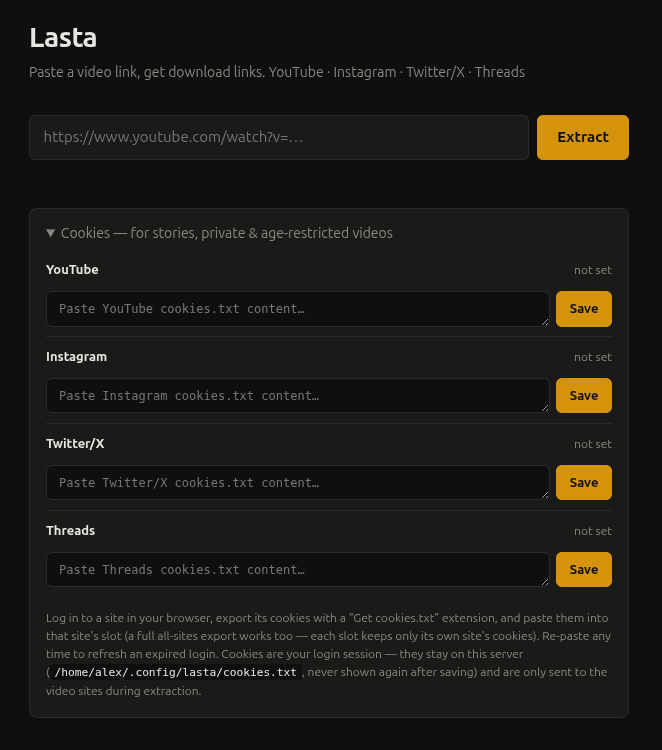

# Lasta

[](https://klppl.github.io/lagom-license/)

Self-hosted video downloader for **YouTube, Instagram, Twitter/X, and Threads**. Paste a link, get the video — 1080p/720p with audio where available, best quality otherwise.

All downloads go through the server: it fetches the video (yt-dlp + ffmpeg merge for YouTube's split streams, native fetch for Threads), then streams the finished mp4 to your browser. No CDN links are handed out — they're often IP-locked and would break on a VPS.



## Run

### Docker (recommended)

The image bundles everything — yt-dlp, ffmpeg, the app. Nothing to install on the host.

```sh
docker build -t lasta .
docker run -d -p 8080:8080 -v lasta-data:/data --name lasta lasta
```

The `/data` volume persists saved cookies. A manual GitHub Actions workflow (`.github/workflows/docker.yml`) builds and pushes the image to ghcr.io. Rebuild the image now and then — it pins the yt-dlp release at build time, and stale yt-dlp versions stop working on YouTube.

### From source

Needs Go 1.22+, plus a **current** `yt-dlp` and `ffmpeg` on `PATH`:

```sh
go run ./cmd/lasta    # http://localhost:8080
```

## Configuration

| Env var | Default | |
|---|---|---|
| `PORT` | `8080` | HTTP port |
| `YTDLP_PATH` | `yt-dlp` | yt-dlp binary |
| `YTDLP_COOKIES` | `<config-dir>/lasta/cookies.txt` | cookie storage location |
| `REQUEST_TIMEOUT_SECONDS` | `30` | per-extraction timeout |
| `DOWNLOAD_TIMEOUT_SECONDS` | `600` | per-download timeout |
| `MAX_CONCURRENT_EXTRACTIONS` | `5` | max simultaneous yt-dlp/download jobs |

## Usage

- **Web UI** — paste a URL, click Extract, pick a quality.
- **Deep links** — append the video URL to the base URL and extraction starts on load:
  `http://localhost:8080/threads.com/@user/post/XXXX` (scheme optional).
- **API** — `POST /extract` with form field `url` and `Accept: application/json` returns metadata and `/download?u=…&h=…` paths; `GET` one to receive the file. `GET /health` → `200 OK`.

### Cookies (stories, private & age-restricted videos)

The Cookies section at the bottom of the page has one slot per site, showing what's saved and when. Export cookies from a logged-in browser ("Get cookies.txt" extension) and paste into the site's slot — re-paste to refresh an expired login, clear per site. Pasted content is filtered to that site's domains, so wrong-slot pastes fail loudly. Cookies are stored server-side (0600), never displayed again, and only sent to the video sites.

> Lasta has no built-in auth. On a public VPS, put it behind a reverse proxy with basic auth or a VPN — anyone with access can use your bandwidth and your saved cookies.

## Adding a site

1. Create `internal/extractor/<site>.go` implementing `Extractor` (`Name`, `Accepts` — use `hostMatches` — and `Extract`). If yt-dlp supports the site, `ExtractJSON` + `BestFormats` do the heavy lifting; wrap failures in the typed errors (`ErrPrivate`, `ErrNotFound`, …).
2. Optionally implement `Downloader` if the site needs native fetching (see `threads.go`).
3. Append it to `Registry` in `internal/extractor/registry.go`. Done.

## Layout

```
cmd/lasta/           entry point
assets.go            go:embed of templates/ + static/
internal/
  config/            env vars
  extractor/         interface, registry, yt-dlp helpers, cookies, one file per site
  handler/           HTTP handlers + chi routes
  server/            graceful shutdown
templates/ static/   HTMX UI (dark, single page)
```
